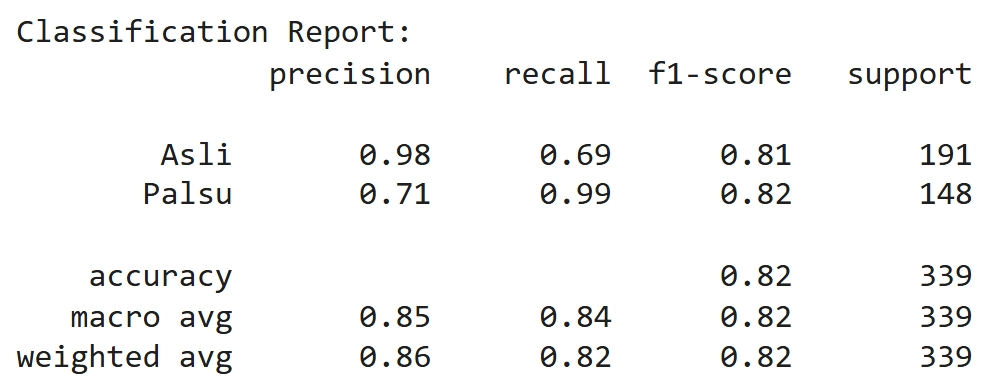
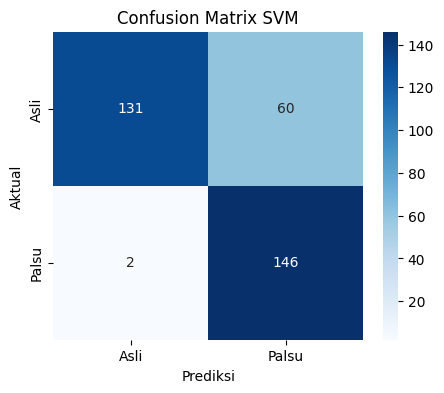

# SIGNATURE AUTHENTICITY DETECTION USING MOBILENETV2 FEATURE EXTRACTION AND SVM
Tugas UAS Pengenalan Pola (UAS-C081)

## Tim
| Nama | NPM |
|---|---|
| Hapsoro Wisnu Murti | 22081010073 |
| Frendiya Mei Sindy | 22081010078 |
| Ama Maulidatul Khairah | 22081010329 |

## Deskripsi
Sistem klasifikasi biner (asli / palsu) pada citra tanda tangan. MobileNetV2 (pretrained ImageNet, tanpa top layer, global average pooling) dipakai sebagai feature extractor (vektor 1280 dimensi), lalu diklasifikasi dengan SVM kernel RBF.

## Pipeline
Pengumpulan data → Preprocessing → Ekstraksi fitur MobileNetV2 → Klasifikasi SVM → Evaluasi

## Hasil (data uji, 339 citra)
Akurasi SVM pada data uji: **82%**

### Classification Report

### Confusion Matrix

Model sangat sensitif terhadap tanda tangan palsu (recall 0,99), tetapi 60 tanda tangan asli masih salah terdeteksi sebagai palsu.

## Link
- [Notebook Colab](https://colab.research.google.com/drive/116eSCJuSgHnyDOMlW5AMlfv7DmV7dlms?usp=sharing)
